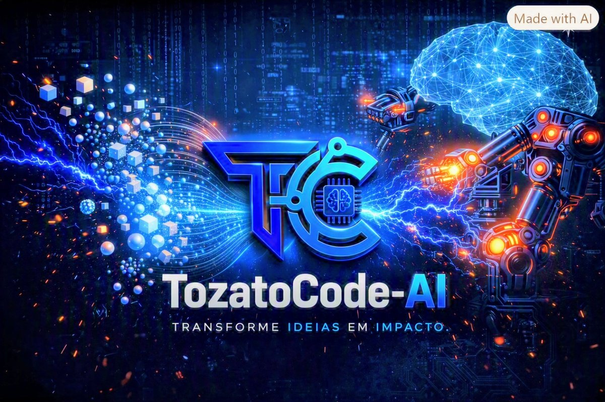

<p align="center">
  
</p>

<h1 align="center">TozatoCode-AI Hub</h1>
<p align="center">
  <a href="https://github.com/Rafael-TOZATO/tozato-dev-hub/commits/main"></a>
  <a href="https://github.com/Rafael-TOZATO/tozato-dev-hub/stargazers"></a>
  <a href="https://github.com/Rafael-TOZATO/tozato-dev-hub/network/members"></a>
</p>

    
  </a>
  <a href="https://jestjs.io/">
    
  </a>
  <a href="https://tozato-dev-hub.vercel.app/">
    
  </a>
  <a href="https://github.com/Rafael-TOZATO/tozato-dev-hub/blob/main/LICENSE">
    
  </a>
  <a href="https://codeql.github.com/">
    
  </a>
  <a href="https://github.com/Rafael-TOZATO/tozato-dev-hub/commits/main/">
    
  </a>
</p>

## Sobre o Projeto

O **TozatoCode-AI Hub** é uma aplicação web interativa que reúne o portfólio profissional, apresenta dados e repositórios públicos do GitHub e oferece um assistente conversacional integrado à API do Google Gemini. O projeto combina engenharia de software e inteligência artificial sob a identidade da **TozatoCode-AI**.

## Validações e Melhorias Recentes

- **Suíte automatizada:** 11 testes com Jest, executados com suporte a módulos ESM. Cobrem CORS, métodos inválidos, mensagem ausente ou vazia, ausência da chave de API, respostas bem-sucedidas, erros da API, bloqueio de segurança e timeout.
- **Smoke tests locais:** a página e os assets foram servidos com HTTP 200; `/api/chat` respondeu 204 ao preflight e 405 a uma requisição GET, conforme esperado.
- **Homologação da integração:** uma chamada de teste à API publicada respondeu HTTP 200.
- **Servidor local:** `npm start` serve a página e encaminha as requisições de `/api/chat` ao handler local. A porta padrão é `3000` e pode ser alterada pela variável `PORT`.
- **CodeQL:** o selo identifica a ferramenta; não indica que a análise automática esteja ativa. O repositório ainda não tem um workflow CodeQL configurado.

## Como Executar o Projeto Localmente

Requer Node.js 18 ou superior.

1. Instale as dependências:

   ```bash
   npm install
   ```

2. Inicie a aplicação:

   ```bash
   npm start
   ```

   Por padrão, o servidor fica disponível em `http://localhost:3000`. Para testar o chat com o Gemini, configure `GEMINI_API_KEY` no ambiente antes de iniciar a aplicação.

3. Em outro terminal, execute os testes:

   ```bash
   npm test

    ```

---

## 🤝 Contribuição e Governança

Contribuições e relatos de bugs são bem-vindos para o aprimoramento contínuo da plataforma.

* **Reportar Bugs:** Abra uma [Issue de Bug](https://github.com/Rafael-TOZATO/NOME-DO-REPOSITORIO/issues/new?template=bug_report.md) detalhando o comportamento esperado, logs e ambiente de execução.
* **Sugestões de Features:** Abra uma [Issue de Melhoria](https://github.com/Rafael-TOZATO/NOME-DO-REPOSITORIO/issues/new?template=feature_request.md).
* **Pull Requests:** Antes de enviar um PR, certifique-se de vincular a uma issue existente para validação do Quality Gate.

Para mais detalhes sobre os padrões de commits e arquitetura, consulte o nosso [Guia de Contribuição](./CONTRIBUTING.md).

---

## 💻 PROJETOS E PORTFÓLIOS
- **App Ecosystem:** [tozato-ai-core.vercel.app](https://tozato-ai-core.vercel.app)
- **H-Folio:** [h-folio-l0.vercel.app](https://h-folio-l0.vercel.app)

## 🐙 CÓDIGO E REPOSITÓRIOS
- **GitHub:** [github.com/Rafael-TOZATO](https://github.com/Rafael-TOZATO)

## ✍️ ARTIGOS E PUBLICAÇÕES
- **Medium:** [medium.com/@ornelas.tozato](https://medium.com/@ornelas.tozato)

## 📬 CONTATOS
- **E-mail:** ornelas.tozato@gmail.com
- **LinkedIn:** [rafaeltozato81](https://www.linkedin.com/in/rafaeltozato81)
- **GitHub:** [Rafael-TOZATO](https://github.com/Rafael-TOZATO)
- **Medium:** [@ornelas.tozato](https://medium.com/@ornelas.tozato)
- **Dev Hub:** [tozato-ai-core.vercel.app](https://tozato-ai-core.vercel.app)
- **H-Folio:** [h-folio-l0.vercel.app](https://h-folio-l0.vercel.app)
- **Microsoft Learn:** [rafaelornelastozato-2209](https://learn.microsoft.com/pt-br/users/rafaelornelastozato-2209)

## Contribuição e Suporte

Encontrou algum erro ou tem sugestões de melhoria? Utilize nossos templates oficiais de governança:

* 🐛 [Relatar um Bug](.github/ISSUE_TEMPLATE/bug_report.md)
