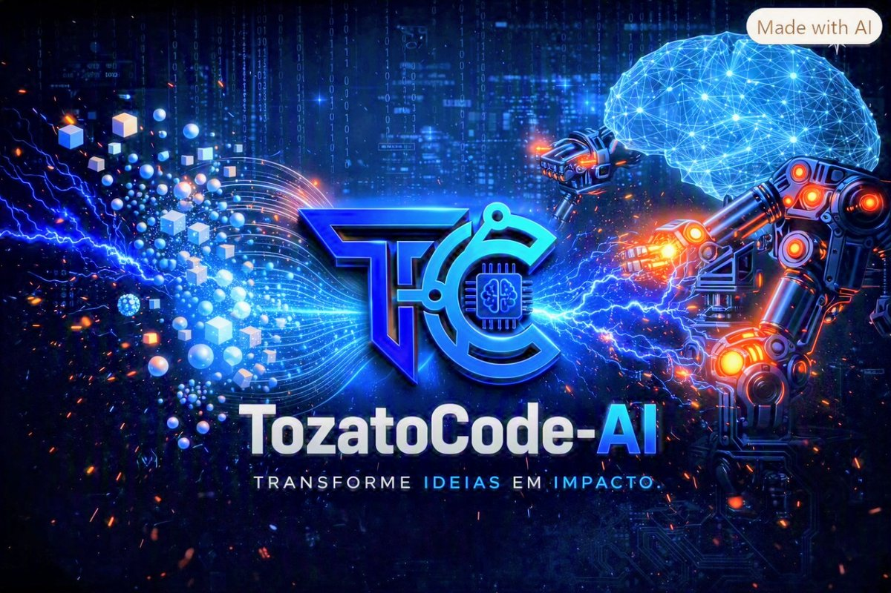

<p align="center">
  
  
  
  
  
  
</p>

<p align="center">
  <a href="https://github.com/Rafael-TOZATO/tozato-dev-hub"></a>
  <a href="https://www.linkedin.com/in/rafaeltozato81"></a>
  <a href="https://medium.com/@ornelas.tozato"></a>
  <a href="https://learn.microsoft.com/pt-br/users/rafaelornelastozato-2209/transcript/dzo2wizrzkx2853"></a>
</p>

<p align="center">
  
</p>

# TozatoCode-AI Hub

> **Autor:** Rafael Ornelas Tozato  
> **Aplicação ao Vivo:** [tozato-dev-hub.vercel.app](https://tozato-dev-hub.vercel.app)  
> **Governança Técnica:** Branch protection ativa  

---

## Sobre o Projeto

Aplicação web interativa desenvolvida para centralizar o portfólio profissional, listagem dinâmica de repositórios via GitHub API e assistente conversacional integrado. O hub une inteligência artificial e engenharia de software sob a identidade visual da **TozatoCode-AI** (*Transforme ideias em impacto*).

---

## Funcionalidades

- **Exibição em tempo real** de dados do perfil do GitHub.
- **Listagem e filtragem** de repositórios públicos.
- **Seção consolidada** de links profissionais e canais de contato.
- **Interface de chat interativa** para suporte e navegação guiada, com backend serverless integrado à API do Gemini.

---

## Tecnologias Utilizadas

- HTML5, CSS3 / Tailwind CSS
- JavaScript (ES6+)
- GitHub REST API
- Vercel (hospedagem e função serverless)
- Google Gemini API

---

## Execução local

Requer Node.js 18 ou superior.

```bash
npm ci
npm start
```

O servidor local fica disponível em `http://localhost:3000` por padrão e aceita uma porta diferente pela variável `PORT`. Ele serve a página estática e encaminha `/api/chat` para a função serverless local. Para testar chamadas reais ao Gemini, configure `GEMINI_API_KEY` no ambiente antes de iniciar o servidor.

## Testes

Execute `npm test` para rodar os testes unitários da função serverless de chat (`api/chat.mjs`). A suíte cobre CORS, métodos inválidos, ausência de configuração, validação da mensagem, respostas bem-sucedidas, erros da API e timeout.

---

## 📬 Contatos

- 💼 **LinkedIn:** [rafaeltozato81](https://www.linkedin.com/in/rafaeltozato81)
- 🐙 **GitHub:** [Rafael-TOZATO](https://github.com/Rafael-TOZATO)
- ✍️ **Medium:** [@ornelas.tozato](https://medium.com/@ornelas.tozato)
- 🌐 **Portfólio PWA (Dev Hub):** [tozato-dev-hub.vercel.app](https://tozato-dev-hub.vercel.app)
- 🌐 **H-Folio:** [h-folio-psi.vercel.app](https://h-folio-psi.vercel.app)
- 🚀 **Aurora BI (Lovable):** [aurora-bi-dio.lovable.app](https://aurora-bi-dio.lovable.app)
- 📜 **Microsoft Learn:** [Transcript](https://learn.microsoft.com/pt-br/users/rafaelornelastozato-2209/transcript/dzo2wizrzkx2853)
